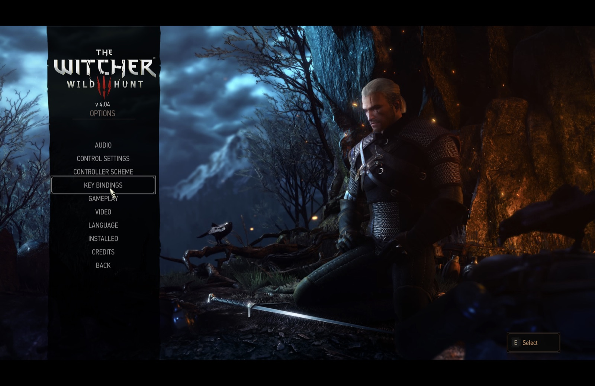

<h1 align="center">ossover</h1>

<p align="center">
  <b>ossover — a free, open-source CrossOver alternative for Apple Silicon Macs, built from evidence.</b><br>
  Build scripts for a Wine engine from CodeWeavers' own LGPL source drop (build in progress), DXMT on Metal, msync,<br>
  bottles, CC0 recipes and a frame-time benchmark harness, driven from one Swift command-line tool.<br>
  No stores, no accounts, no telemetry. Today's verified engine is frankea's third-party Whisky Libraries build.
</p>

<p align="center">
  
  
  
  
  
</p>

<br>

<p align="center">
  
  <br>
  <sub>The Witcher 3: Wild Hunt 4.04 (© CD PROJEKT S.A.) running in an ossover bottle on an Apple M5 Pro, DXMT renderer</sub>
</p>

> [!NOTE]
> **ossover is alpha software.** One game has been verified so far (The Witcher 3: Wild Hunt 4.04, DirectX 11), on one
> machine (Apple M5 Pro, macOS 26.7.1), on the bootstrap engine. There is no GUI yet, no DirectX 12, and no benchmark
> numbers have been published: the harness exists, the runs have not been done. The [Status](#status) block below is
> the honest picture.

<p align="center">
  <a href="#what-works-today">What works today</a> ·
  <a href="#how-it-works">How it works</a> ·
  <a href="#get-started">Get started</a> ·
  <a href="#build-your-own-engine">Build your own engine</a> ·
  <a href="#how-it-was-built">How it was built</a> ·
  <a href="#status">Status</a> ·
  <a href="#roadmap">Roadmap</a> ·
  <a href="#contributing">Contributing</a> ·
  <a href="#security">Security</a> ·
  <a href="#licence">Licence</a>
</p>

<br>

<table>
  <tr>
    <td width="20%" valign="top">
      <h3>🔬 Evidence-based</h3>
      Designed from a reverse-engineering pass on the real CrossOver 26.3.0 with <a href="https://github.com/morluto/rea">REA</a>: bundle inventory, signatures, dyld traces, the plain-text launcher and the LGPL sources, within the licence. 82 ledger rows; every design decision cites one.
    </td>
    <td width="20%" valign="top">
      <h3>⚙️ Open engine</h3>
      Build scripts for a Wine engine from CodeWeavers' own LGPL source drop (msync, <code>macdrv_functions</code>, D3DMetal hooks) plus DXMT and MoltenVK: SHA-256-pinned inputs, relocatable, ad-hoc signed, twenty gates before it ships. <b>Build in progress</b>; every verified result so far ran on frankea's third-party bootstrap build.
    </td>
    <td width="20%" valign="top">
      <h3>🎮 No Steam client needed</h3>
      DRM-free depots are fetched with <code>steamcmd</code> straight into the bottle and the game version is pinned. Your password goes to steamcmd's own prompt in your terminal; ossover never sees it.
    </td>
    <td width="20%" valign="top">
      <h3>📄 Recipes as data</h3>
      One CC0 JSON file per game: Windows version, sync, renderer, registry, ini edits, environment, winetricks verbs, the program to run. Plan it with <code>--dry-run</code>, apply it, share it.
    </td>
    <td width="20%" valign="top">
      <h3>📈 Bench harness</h3>
      Apple's Metal Performance HUD logs every frame; ossover turns that into average fps, 1% low, p50 and GPU time, three-run median, as JSON under the bottle. <code>bench attach</code> measures a CrossOver run the same way.
    </td>
  </tr>
</table>

<br>

## What works today

Verified on an Apple M5 Pro running macOS 26.7.1, 2026-10-14. "Pending" means the harness exists and the run has not
been done; nothing here is estimated.

| What | State |
|---|---|
| **The Witcher 3: Wild Hunt 4.04** (Steam `next-gen` branch, DirectX 11 exe) | **Runs, playable.** Reaches the main menu and in-game in an ossover bottle on the bootstrap engine with DXMT and msync, fetched as a Steam depot with no Steam client in the bottle. Benchmark numbers: **pending**. |
| DXMT (Direct3D 11 → Metal) | Default renderer. Confirmed as the D3D11 provider inside a bottle by a probe (adapter reported as Apple M5 Pro, wined3d never loaded). DXMT 0.80 has no geometry-shader stream output (logged 7× at The Witcher 3's first launch), so some effects may be missing. |
| DXVK-macOS (Direct3D 11 → Vulkan → MoltenVK) | Optional pack, kept for the benchmark matrix. Not for playing The Witcher 3: MoltenVK lacks transform feedback, so sirens, rotfiends and hounds are invisible (DXMT 0.80 shares this gap: no stream output either; D3DMetal is the only macOS path that has it). |
| D3DMetal (Apple Game Porting Toolkit) | **User-import only.** `ossover renderer import-gptk <dmg>` from the disk image you download from Apple after accepting their licence; never downloaded or redistributed by ossover. Needs the own engine (`WINEDLLPATH_PREPEND`), so not usable on the bootstrap engine yet. |
| Own engine (`x64-ossover-cx26.3-r1`, built from CodeWeavers' LGPL sources) | Build, package and gate scripts in [`engine/`](engine/); build in progress, **not yet packaged**. |
| DirectX 12 | **Not yet.** |
| Epic Games Store, GOG | **Not yet** (planned via Legendary and gogdl, see the [roadmap](ROADMAP.md)). |
| Steam client inside a bottle | Fallback recipe only ([`recipes/steam.json`](recipes/steam.json)), untested. |
| Graphical app | **Not yet.** Command line only. |
| Notarized builds | **Not yet.** Build from source. |

## How it works

- **Engine.** An x86_64 WoW64 Wine build, run under Rosetta 2, installed from a manifest in [`engines/`](engines/)
  that pins the download URL and SHA-256. Today's bootstrap engine is frankea's Whisky Libraries v4.6.4-beta.1
  (Wine 11.16 + the CrossOver 26.3 LGPL patch set + DXMT 0.80). The own engine is to be built in [`engine/`](engine/) from
  the CrossOver 26.3.0 LGPL source tarball (Wine 11.0 plus CodeWeavers' macOS hacks: msync, `macdrv_functions`, the
  D3DMetal host hooks) with three small patches. Capabilities (`msync`, `esync`, `wow64`, `macdrvExports`,
  `dllPathPrepend`, `d3dmetalHost`) are probed from the binaries at install, not taken on trust from the manifest.
- **Renderer overlays.** DXMT, DXVK and D3DMetal are overlays over Wine's builtin Direct3D. On an engine without
  the `WINEDLLPATH_PREPEND` patch (the bootstrap engine) ossover copies `d3d11`/`dxgi`/`d3d10core` into the prefix's
  `system32` with Wine's builtin mark stripped and sets `n,b` overrides (strategy B). On the own engine it prepends
  the overlay directory to Wine's DLL search path and touches nothing in the prefix (strategy C), the open
  equivalent of what CrossOver's proprietary `cxcompatdb.so` does through the exported `prepend_dll_path()`.
- **Bottles.** `~/Library/Application Support/ossover/bottles/<name>/{bottle.json, prefix/, logs/, results/}`.
  A 64-bit Windows 10 prefix by default, msync whenever the engine has it, RetinaMode on, user folders isolated
  inside the prefix. Settings live in `bottle.json`; `winecfg -v` and batched `.reg` files push them into the prefix.
- **Recipes.** CC0 JSON in [`recipes/`](recipes/) (schema: [`recipes/_schema.json`](recipes/_schema.json)) with
  steps `winver`, `sync`, `renderer`, `retina`, `registry`, `dlloverride`, `env`, `winetricks`, `file`, `ini`, `copy`,
  `program`, `note`; `when` predicates on platform, locale and engine capabilities; `status`/`reports` as the open
  counterpart of a CrossTie medal.
- **CLI.** `ossover doctor | engine | renderer | bottle | run | recipe | steam | smoke | bench`. Everything is plain
  files under `$OSSOVER_HOME`; there is no daemon. `OssoverKit` is a Swift library the CLI (and the future app) sit on.

## Get started

You need an Apple Silicon Mac on macOS 15 or later, Xcode with a Swift 6.1+ toolchain, Rosetta 2 (the Wine side is
x86_64), and Homebrew for two helpers.

```sh
softwareupdate --install-rosetta --agree-to-license   # once; asks for your password
brew install cabextract                                 # winetricks verbs used by recipes
brew install --cask steamcmd                            # Steam depot fetch (Intel binary, runs under Rosetta)

git clone https://github.com/hemkum/ossover
cd ossover
swift build -c release
export PATH="$PWD/.build/release:$PATH"                 # or: swift run ossover ...

ossover doctor                                          # Rosetta, engines, renderers, steamcmd, cabextract, Accessibility
```

Install the bootstrap engine (481 MB download, SHA-256 verified) and create a bottle. Manifests and recipes are read
from the repository checkout, so run from it or set `OSSOVER_REPO`.

```sh
ossover engine install engines/x64-frankea-wine11.16-cx26.3-v4.6.4b1.json
ossover bottle create witcher3 --engine x64-frankea-wine11.16-cx26.3-v4.6.4b1 \
    --winver win10 --sync msync --renderer dxmt
```

Fetch The Witcher 3 (Steam app 292030, branch `next-gen` = 4.04, the DirectX 11 build) into the bottle. steamcmd runs
in your terminal and asks for the password and Steam Guard code itself. The fetch is pinned afterwards: a second
fetch needs `--allow-update`, so Steam cannot move you to the DirectX-12-only 5.x Remastered.

```sh
ossover steam branches 292030 --user <steam-user>       # confirm the branch key
ossover steam fetch --bottle witcher3 --app 292030 --branch next-gen --user <steam-user> \
    --dest 'C:\Games\The Witcher 3'
```

Apply the recipe (HairWorks off, borderless 2560x1600, DirectX 11 launcher fallback, program entry) and run.

```sh
ossover recipe apply witcher3 --bottle witcher3 --dry-run   # the plan
ossover recipe apply witcher3 --bottle witcher3
ossover run witcher3 witcher3                               # <bottle> <program>; wine log streams to stdout
```

Smoke-test and benchmark (the benchmark needs a save in Hierarch Square, Novigrad, and Accessibility access for the
key press, or `--manual-load`):

```sh
ossover smoke --bottle witcher3 --program witcher3
ossover bench run --bottle witcher3 --program witcher3 --runs 3
ossover bench run --bottle witcher3 --program witcher3 --renderer dxvk --sync none   # the matrix, same bottle
```

`ossover help <subcommand>` documents every flag. Logs are under the bottle's `logs/`, benchmark output under
`results/<timestamp>/`.

## Build your own engine

[`engine/README.md`](engine/README.md) walks through building `x64-ossover-cx26.3-r1` from CodeWeavers' CrossOver
26.3.0 LGPL source tarball with Xcode clang, MacPorts (x86_64) and mingw-w64: pinned inputs in
[`engine/inputs.json`](engine/inputs.json), the three patches in [`engine/patches/`](engine/patches/), `build.sh`,
`package.sh` (dependency closure, rpath rule, ad-hoc signing, manifest), `gates.sh` (twenty release gates) and
`selftest.sh` (the packaging policy on a synthetic tree, ten seconds, no build needed). Expected cold build: 30–45 min
on an M5 Pro (the plan's estimate, §5; not yet measured, ledger row L-81).

## How it was built

ossover started with a reverse-engineering pass on CrossOver 26.3.0 (the trial bundle and the LGPL source tarball)
using [REA](https://github.com/morluto/rea) and Ghidra, inside the limits of CodeWeavers' EULA: inventory, signing,
dyld traces, Mach-O surfaces, the plain-text Perl launcher and bottle templates, and a deep dive into the LGPL Wine
binaries and sources. The proprietary GUI, the `.pyc` tooling and `cxcompatdb.so` were never decompiled and nothing was
copied. The result is an evidence ledger of 82 rows, each marked observed, inferred or unknown with its authority and
evidence IDs, and 39 design decisions that cite them ([`docs/rea/`](docs/rea/)). The raw REA and shell records behind
the ledger are not in the git tree: they are published as the GitHub Release asset
`docs-rea-evidence-crossover-26.3.0.tar.xz` (+ `.sha256`); extract it into `docs/rea/evidence/` to resolve the
`evidence/…` citations.

The code, the engine scripts, the recipes, the harness and these documents were written with **Claude Fable 5.1 in
Claude Code**, by an orchestrated multi-agent workflow: a plan, then agents with file ownership for each pass and each
module, an adversarial verification pass over the ledger, reviewers, and a human doing what only a human can (the
passwords, the Steam login, the licence decisions, the save game). The approach is modelled on how
[ArtCraft](https://getartcraft.com/)'s [PhotoCraft](https://github.com/storytold/photocraft) shipped a clean-room
alternative to Adobe Photoshop. The full account, including what the evidence changed, is in
[`docs/how-it-was-built.md`](docs/how-it-was-built.md).

> [!IMPORTANT]
> **Status: alpha.** What is missing, plainly: the own engine is not yet packaged (the bootstrap engine is a
> third-party build); there is no GUI; there is no DirectX 12; exactly one title has been verified, on one Mac;
> there are no notarized builds; and the benchmark numbers (including the comparison with CrossOver 26.3) are
> **pending**, not measured. Expect rough edges. Please file issues with your Mac model, macOS version, engine id,
> renderer, the recipe you applied and the log from the bottle's `logs/` directory.

## Roadmap

[`ROADMAP.md`](ROADMAP.md): v0.1 benchmark results, the own engine and a notarized CLI; v0.2 a SwiftUI app, GPTK
import UX, more recipes, Epic Games Store via Legendary and GOG via gogdl; v0.3 an arm64 + FEX engine for the
post-Rosetta world and the KosmicKrisp / DXVK ≥ 2 path.

## Contributing

Start with [`AGENTS.md`](AGENTS.md), which is written for AI agents and people alike: build and test commands, who
owns which directory, and the rules (evidence first, never copy CrossOver's proprietary code, never invent numbers).
The most useful contributions right now:

- **Benchmark runs** on other Apple Silicon Macs, as `result.json` files (see [`docs/benchmark.md`](docs/benchmark.md)).
- **Recipes** for other games (CC0; include `status` and a `reports` entry with your hardware and engine).
- **Engine builds** on other macOS versions, and failures of `engine/gates.sh`.
- **Bug reports** with the bottle log attached.

`swift test` must pass; it needs no Wine. Code is GPL-3.0-or-later with SPDX headers; recipes are CC0.

## Security

ossover downloads only what a manifest in this repository pins by URL and SHA-256 (engines, renderer packs,
wine-mono, wine-gecko) and refuses an unpinned source. It never downloads game installers, the Steam client or
Apple's Game Porting Toolkit. It never reads a password: steamcmd prompts in your own terminal. Engine binaries are
ad-hoc signed and `exec`'d directly; quarantine is stripped only from the verified archive. To report a vulnerability,
use GitHub's private vulnerability reporting on this repository (Security → Report a vulnerability) rather than a
public issue.

## Licence

ossover is licensed under the [GNU General Public License v3.0 or later](LICENSE) (`GPL-3.0-or-later`).
Copyright © 2026 Hemant ([hemkum](https://github.com/hemkum)) and the ossover contributors.

Recipes and the compatibility data under [`recipes/`](recipes/) are dedicated to the public domain under
[CC0 1.0](LICENSES/CC0-1.0.txt). Code adapted from [Whisky](https://github.com/Whisky-App/Whisky) and
[highball](https://github.com/gauthierpiarrette/highball) (both GPL-3.0) keeps its copyright notice in the file
header, as listed in [`NOTICE.md`](NOTICE.md). Every component ossover downloads, builds or vendors, with its licence,
is tabled in [`ATTRIBUTION.md`](ATTRIBUTION.md); why the licences are what they are, what the LGPL asks of the engine,
and why D3DMetal is never redistributed are explained in [`docs/licensing.md`](docs/licensing.md).

Nothing in this repository is copied from CodeWeavers CrossOver's proprietary components. Behaviour was observed;
code was not reused.

<sub>CrossOver and CodeWeavers are trademarks of CodeWeavers, Inc. Apple, macOS, Metal, Game Porting Toolkit and
D3DMetal are trademarks of Apple Inc. Wine is a registered trademark of the Software Freedom Conservancy; WineHQ is
the Wine project. Steam and Valve are trademarks of Valve Corporation. The Witcher and CD PROJEKT are trademarks of
CD PROJEKT S.A. Epic Games and the Epic Games Store are trademarks of Epic Games, Inc. GOG is a trademark of GOG sp. z
o.o. ossover is an independent, open-source project and is not affiliated with, sponsored by or endorsed by
CodeWeavers, Apple, the Wine project, Valve, CD PROJEKT, Epic Games or GOG; these names are used only to describe
compatibility.</sub>
